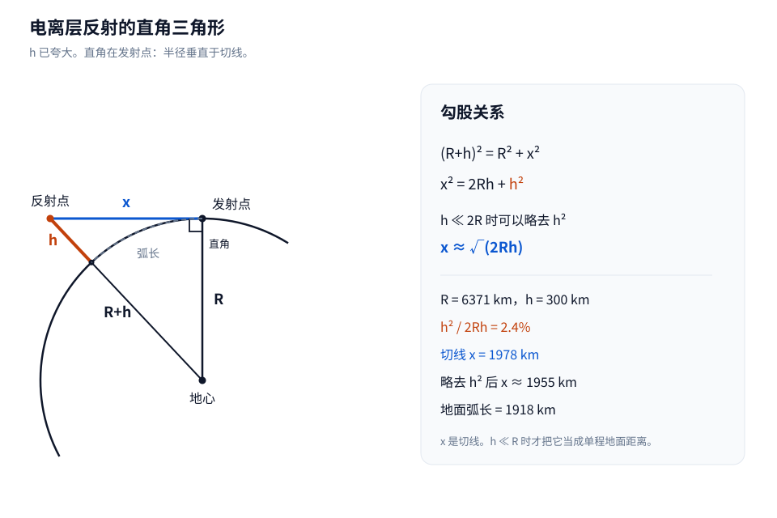
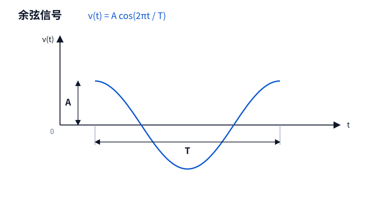
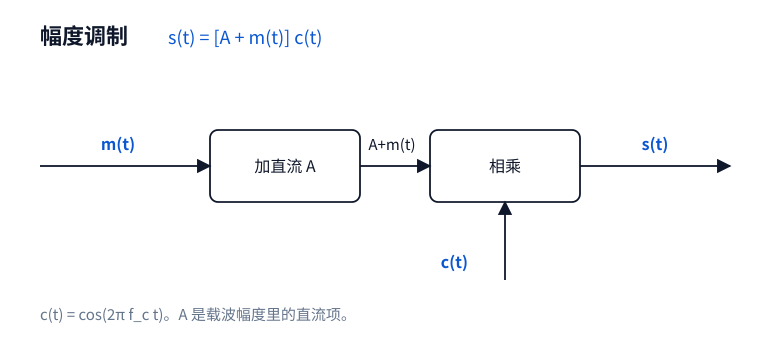
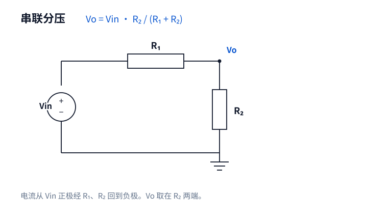

# ee-study-figure

电子信息课程用的 Cursor 技能。把豆包、DeepSeek 或教材里的一段讲解画成 SVG 示意图，让图上的标注和公式是同一套关系。

聊天机器人讲反射、波形、框图和电路时，有时不画图，改用字符拼一张示意图。字符对不齐时，直角和斜边会看错。这个技能在 Cursor 里把那段讲解画成可以放进笔记的图。

## 示例

电离层反射。原讲解把地球半径 `R` 和距离 `x` 排在同一条直线上，同时把 `R+h` 写成斜边。按这个等式，直角在发射点：`R` 沿半径，`x` 沿切线。`h` 在图上被夸大，否则几乎看不见。



另外三类的完成度：







## 能画的四类

- 几何模型：反射、视距、直角三角形
- 波形和频谱
- 系统框图
- 基础电路，例如分压。不画 PCB，也不画器件照片

## 安装

豆包工作里上传技能时，选择本文件夹。`SKILL.md` 就在这一层。

在 Cursor 里使用时，把本文件夹复制到个人技能目录。

Windows：

```bat
xcopy /E /I . %USERPROFILE%\.cursor\skills\ee-study-figure
```

macOS / Linux：

```bash
mkdir -p ~/.cursor/skills
cp -R . ~/.cursor/skills/ee-study-figure
```

## 使用

把豆包或 DeepSeek 的讲解粘贴到 Cursor，然后说：

```text
按 ee-study-figure 画成示意图
```

图写到当前项目的 `figures/` 目录。回复里会说明每个符号、等式，以及近似在什么条件下成立。

## 检查示例

只使用 Python 标准库：

```bash
python scripts/build_examples.py
python scripts/check_examples.py
```

## 目录

- `SKILL.md`：技能说明
- `examples/`：四张示例图
- `scripts/check_svg.py`：检查图是否自包含、是否带上指定标注
